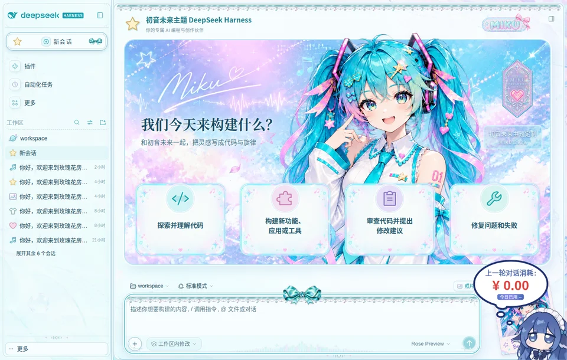
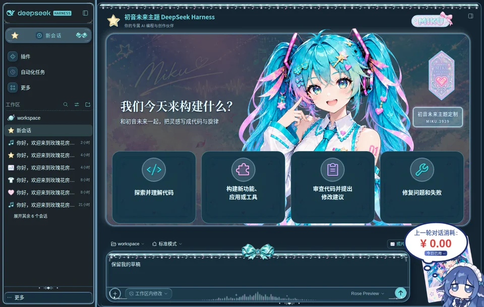

# 初音未来 · DeepSeek Harness 主题

将初音星光舞台、独立人物、照片与青紫珠光界面带到 DSH Web。支持手机、浅色与深色，以及欢迎页、对话页和原生输入框。

**Compatible with: dsh 0.2.1-rc.5** · Node.js ≥ 22。

## 安装并启用

初音主题由专用管理器挂载；请一次安装这两个包，不需要玫瑰主题：

```sh
dsh plugin --profile web add dsh-plugin-ekko-skin-manager@0.1.3 dsh-plugin-miku-theme@0.2.3
```

安装后刷新 DSH 网页；全新浏览器会默认启用已安装的初音主题。也可打开 **账号菜单 → 设置 → Ekko 皮肤 → 初音未来**。

如果你使用的 profile 不是 `web`，把命令中的 `web` 换成实际名称。请使用 DSH 的 `plugin add`，它会同时安装包并启用对应 bundle；只在其他目录执行 `npm install` 不会启用 DSH 插件。

首次启动 DSH 时，先在原生“预览版说明”中点击“继续”。主题不附带模型服务；正常对话仍需按 DSH 的流程配置模型和工作区。

## 其他安装途径

从 GitHub 安装，源码仓库已包含构建产物与完整素材，无需本机构建或 Ekko 源码：

```sh
dsh plugin --profile web add github:cjjchina3088191870-sudo/dsh-plugin-ekko-skin-manager#v0.1.3 github:cjjchina3088191870-sudo/dsh-plugin-miku-theme#v0.2.3
```

也可从两个仓库的 GitHub Releases 下载 `.tgz`，在下载目录执行：

```sh
dsh plugin --profile web add ./dsh-plugin-ekko-skin-manager-0.1.3.tgz ./dsh-plugin-miku-theme-0.2.3.tgz
```

## 主题效果





- 星光欢迎舞台、原版独立人物、四张可点击灵感卡片、可收起的照片。
- 音符、星星、图片、衣服、爱心五种固定会话图标，保留原生状态和菜单。
- 青银音符饰边、宝石蝴蝶结、双层输入框与侧栏饰框，焦点与悬浮反馈。
- 按可用视区分配手机舞台高度，输入框下方保留约 14px；折叠按钮与新会话图标保持对齐。
- 点击灵感卡片只追加草稿，不自动发送；切换主题保留草稿、会话及工作区。
- 主题装饰偏好在管理器内设置，外部挂件按自己的布局运行。

## 更新与停用

```sh
dsh plugin --profile web update dsh-plugin-miku-theme dsh-plugin-ekko-skin-manager
```

临时停用外观时，在 **设置 → Ekko 皮肤** 选择 **原生界面**。不要单独关闭管理器后留下主题提供者。

卸载时：

```sh
dsh plugin --profile web remove dsh-plugin-miku-theme
```

如果不再使用其他 Ekko 主题，也可移除管理器。

## 首次安装排查

- 安装后无变化：确认安装命令包含管理器，然后刷新网页，进入“设置 → Ekko 皮肤”。
- 以前选择过玫瑰但只安装初音：管理器 0.1.3 会自动回退到已安装主题，不会一直等待缺失主题。
- 页面提示素材加载失败：检查浏览器网络中 `/ekko-skins/assets/miku/` 的请求，并重试选择主题；反向代理应保留此路径。
- 已有旧“皮肤管理”插件：按管理器 README 的迁移说明处理，避免两个管理器同时控制同一主题。

## 源码开发

```sh
npm install --ignore-scripts
npm run build
npm test
npm pack
```

发布包包含 `lib/`、素材清单与哈希文件。运行不依赖 Ekko、本项目开发目录、构建工具或私有文件；无安装生命周期脚本。开发时可设置 `EKKO_THEME_SOURCE` 同步原始素材，`DSH_MIKU_TOOLCHAIN` 仅用于复用构建工具。

## 许可和素材来源

新增适配代码为 MIT；继承素材、人物、图标与名称保留原权利及许可，不随适配代码重新授权。详见 `LICENSE`、`NOTICE`、`THIRD_PARTY_LICENSES/` 与 `assets/ORIGIN.json`。新增星光饰边是独立生成的透明装饰素材。
