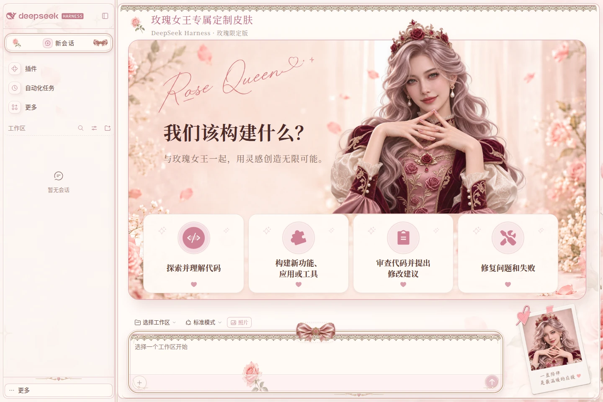
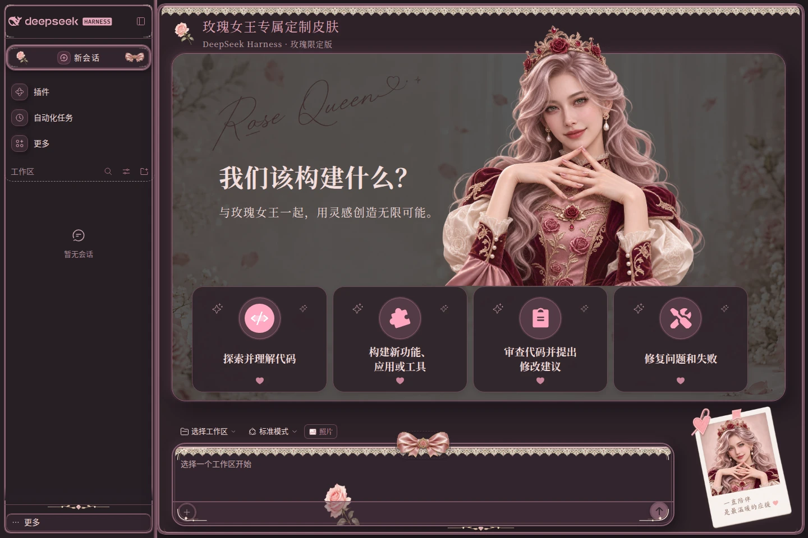
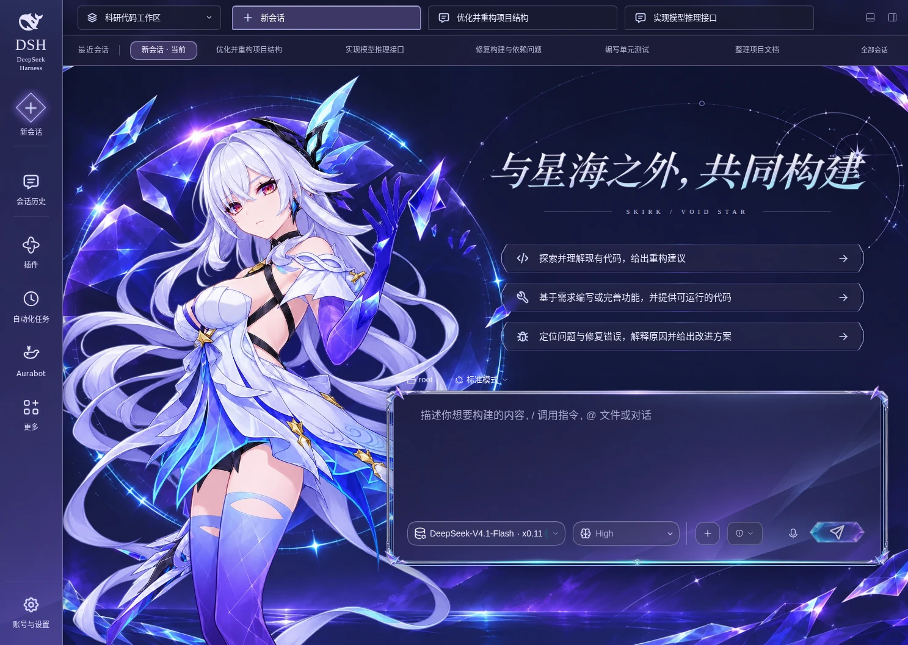
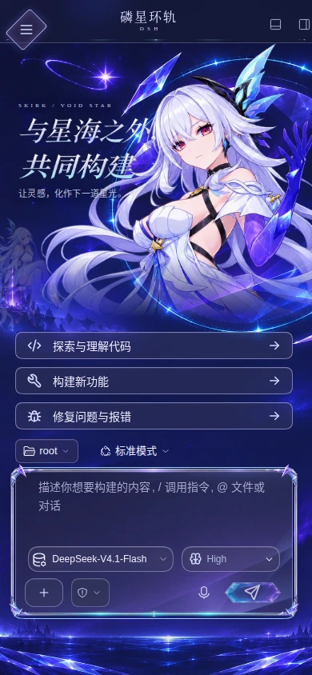

# 初音未来・玫瑰女王・丝柯克 · DeepSeek Harness 主题套装

一个安装包，三种创作氛围：青绿与粉紫星光的初音未来、奶油玫瑰花房中的原创虚拟玫瑰女王，以及冰紫晶体星海中的丝柯克。初音与玫瑰提供浅色、深色外观；丝柯克采用深蓝紫星海风格。三款主题均适配手机，内置统一主题管理与电脑、手机独立启动视频设置。

## 主题预览

| 玫瑰女王 · 浅色 | 玫瑰女王 · 深色 |
| --- | --- |
|  |  |

| 初音未来 · 浅色 | 初音未来 · 深色 |
| --- | --- |
|  |  |

| 丝柯克 · 桌面 | 丝柯克 · 手机 |
| --- | --- |
|  |  |

## 主要功能

- **三款主题一起安装**：在同一管理界面切换初音未来、玫瑰女王与丝柯克，各自记住外观与视频设置。
- **原创玫瑰女王**：中国面孔、黑棕长发、玫瑰珍珠冠饰与浅粉蕾丝礼服，人物立绘和右下角照片采用一致的虚拟形象。
- **完整的初音风格**：星光舞台、人物立绘、拍立得照片、宝石蝴蝶结与青银饰边。
- **丝柯克 · 磷星环轨**：晶体星环、银白冰蓝艺术字与双侧聊天人物，手机端使用独立竖屏构图。
- **会话与输入框装饰**：主题导航、立体输入框，以及可填入常用提示的欢迎页入口；初音与玫瑰另有五种会话图标。
- **自由调整外观**：按主题调整人物、照片装饰与对话背景浓度。
- **两种手机导航**：左上角按钮与抽屉，或左侧纵向图标栏。
- **独立的电脑与手机启动视频**：分别上传横屏、竖屏或其他比例的视频，支持声音、音量、预览和随时跳过。

## 安装与使用

适配 DSH 0.2.2-rc.1。安装套装：

```sh
dsh plugin --profile web add dsh-plugin-miku-theme
```

重启 DSH 并刷新网页，打开 **账号菜单 → 设置 → Ekko 皮肤**，选择 **初音未来**、**玫瑰女王** 或 **丝柯克 · 磷星环轨**。

三款主题和管理功能已包含在同一个包中。使用其他 profile 时，将命令中的 `web` 替换为对应名称。

## 启动视频
进入 **设置 → Ekko 皮肤 → 所选主题 · 启动视频**，选择 **电脑端视频** 或 **手机端视频**。

- 支持上传 **MP4 / WebM**，每个视频最大 **96 MiB**。
- 电脑端推荐 **16:9 横屏**，手机端推荐 **9:16 竖屏**，也支持其他分辨率与比例。
- 两端分别设置“铺满屏幕”或“完整显示”；手机端未上传时自动沿用电脑端视频。
- 可调节声音、音量与最长播放时间，上传后保存设置并刷新页面生效。
- 内置片段提供 **MP4 与 WebM 两种编码**，浏览器可选择支持的格式，加载失败时会尝试另一种编码。上传与内置片段相同的文件时，也会匹配这份备用编码。
- 可预览启动效果、恢复默认视频；播放时点击画面、点击“跳过视频”或按 `Esc` 即可进入 DSH。

其他自定义视频按其原有编码播放。系统开启“减少动态效果”时会跳过自动启动播放，手动预览仍可使用。


视频素材感谢项目 https://github.com/Something11235/dsh-video-skin
## 手机布局

| 左上角按钮与抽屉 | 左侧纵向图标栏 |
| --- | --- |
|  |  |

在 **设置 → Ekko 皮肤 → 手机导航方式** 中切换；人物、照片和对话背景也可以按喜好调整。

## 从旧版升级

新版套装已包含三款主题与完整管理功能。安装过独立管理器的用户，可移除管理器后安装套装：

```sh
dsh plugin --profile web remove dsh-plugin-ekko-skin-manager
dsh plugin --profile web add dsh-plugin-miku-theme
```

完成后重启 DSH 并刷新网页。主题偏好和已保存的视频会保留。

## 更新

重新执行上方安装命令，安装 npm 最新版本，再重启 DSH 并刷新网页。

本次更新加入丝柯克主题与新的玫瑰女王形象，并修复三款主题首次从首页进入聊天时残留首页输入框定位的问题；切换时保留原生编辑器与草稿。

## 停用与卸载

在 **设置 → Ekko 皮肤** 中选择 **原生界面**，即可恢复默认外观。

```sh
dsh plugin --profile web remove dsh-plugin-miku-theme
```

## 许可

代码与美术素材的使用条款见 [LICENSE](LICENSE)、[NOTICE](NOTICE) 和 [第三方许可](THIRD_PARTY_LICENSES)。

启动视频素材与功能参考感谢 [dsh-video-skin](https://github.com/Something11235/dsh-video-skin)。

## 丝柯克 · 磷星环轨

第三款深蓝紫主题已接入统一管理。电脑端首页使用星海舞台，聊天页采用双侧人物与居中阅读区；手机端有独立构图与双行输入工具栏。支持独立上传电脑和手机启动视频，此主题默认不附带片段。
