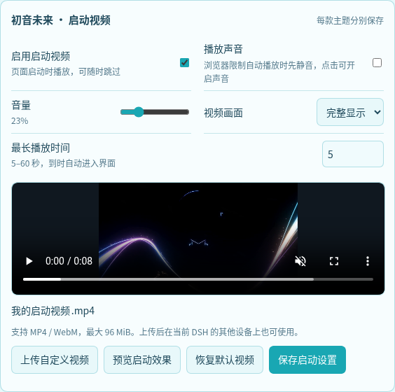

# 初音未来主题 · DeepSeek Harness

为 DeepSeek Harness 换上青绿、粉紫与星光交织的初音未来界面。支持浅色、深色外观，以及桌面和手机布局。内置主题管理与启动视频，单独安装即可使用。

## 预览

| 浅色 | 深色 |
| --- | --- |
|  |  |

## 特色

- 星光舞台、人物立绘与拍立得装饰。
- 启动视频支持声音、音量、画面比例、预览和随时跳过。
- 可上传自己的 MP4 / WebM 视频，每款主题分别保存。
- 自动识别已安装的初音与玫瑰主题，统一切换和设置。
- 音符、星星、图片、衣服、爱心五种会话图标。
- 宝石蝴蝶结、青银饰边和立体输入框。
- 点击欢迎页卡片，将常用提示加入输入框。
- 自由调整人物、照片和背景浓度。
- 手机支持左上角按钮与抽屉、左侧纵向图标栏两种导航方式。

## 安装

适配 DSH 0.2.2-rc.1。安装主题：

```sh
dsh plugin --profile web add github:cjjchina3088191870-sudo/dsh-plugin-miku-theme#main
```

重启 DSH 并刷新网页，在 **账号菜单 → 设置 → Ekko 皮肤** 中选择 **初音未来**。

使用其他 profile 时，将命令中的 `web` 替换为对应名称。

## 手机效果

| 左上角按钮与抽屉 | 左侧纵向图标栏 |
| --- | --- |
|  |  |

在 **设置 → Ekko 皮肤 → 手机导航方式** 中切换。两种模式用于竖屏手机，横屏和桌面保持各自的布局。

## 启动视频

在 **设置 → Ekko 皮肤 → 初音未来 · 启动视频** 中开关视频、调节声音和音量，选择铺满屏幕或完整显示。

- 支持上传 **MP4 / WebM，最大 96 MiB**，保存后刷新页面即可使用。
- 上传的视频可在当前 DSH 的其他设备上使用；两款主题的视频和偏好互不覆盖。
- 可先预览启动效果，也可以恢复默认视频。
- 播放时点击画面、点击“跳过视频”或按 `Esc` 即可进入界面；自动播放受限时可点击开启声音。
- 加载失败会自动进入 DSH；系统开启“减少动态效果”时跳过自动播放。



安装另一款兼容主题并按 DSH 提示刷新或重启后，它会自动出现在同一管理界面。只会显示一份管理界面和当前选中的主题。

## 从旧版升级

旧版独立管理器（0.1.x）用户先卸载旧管理器，再安装新版主题；主题偏好会保留：

```sh
dsh plugin --profile web remove dsh-plugin-ekko-skin-manager
dsh plugin --profile web add github:cjjchina3088191870-sudo/dsh-plugin-miku-theme#main
```

新版兼容管理器（0.2.x）也可以保留，它与主题共用同一个管理界面。

## 更新

```sh
dsh plugin --profile web update dsh-plugin-miku-theme
```

更新后重启 DSH 并刷新网页。

## 停用与卸载

在 **设置 → Ekko 皮肤** 中选择 **原生界面**，即可恢复默认外观。

卸载主题：

```sh
dsh plugin --profile web remove dsh-plugin-miku-theme
```

## 许可

代码与美术素材的使用条款见 [LICENSE](LICENSE)、[NOTICE](NOTICE) 和 [第三方许可](THIRD_PARTY_LICENSES)。


### 电脑端与手机端视频

启动视频设置提供“电脑端视频”和“手机端视频”两个入口，可以分别上传、预览，并设置铺满屏幕或完整显示。推荐电脑端使用 16:9 横屏、手机端使用 9:16 竖屏，也支持其他分辨率与比例。手机端未单独上传时自动沿用电脑端视频，已保存的启动设置会继续保留。

每个视频支持 MP4 / WebM，最大 96 MiB。本地预览失败不会阻止上传；视频保存后可以在支持对应编码的设备上播放。

内置启动片段同时提供 MP4 与 WebM 编码，浏览器可选择支持的格式，加载失败时自动尝试另一个来源。上传与内置片段完全相同的文件时，也会匹配这份备用编码；其他自定义视频按其原有编码播放。
